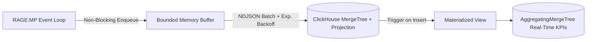

# Highload ClickHouse Analytics Pipeline (MergeTree + Join Avoidance + Batch Ingester)

Аналитический конвейер реального времени для игровых серверов (RAGE:MP / alt:V) на базе **ClickHouse** и **Node.js**, спроектированный для записи сотен тысяч событий телеметрии и экономики без `JOIN` в запросах и без блокировки игрового Event Loop.

## Архитектура данных



## Инженерные решения в DDL и инжестере

1. **Join Avoidance & Денормализация (`sql/01_denormalized_events.sql`):**
   Контекст игрока (`account_id`, `faction_id`, `vip_tier`) записывается непосредственно в широкую таблицу фактов `player_session_telemetry` в момент события. Аналитические выборки выполняются линейным сканированием колонок без дорогостоящих распределенных `JOIN`.
2. **Партиционирование, ключи сортировки и `PROJECTION`:**
   * Таблица партиционирована по дням (`PARTITION BY toYYYYMMDD(event_date)`) с автоматическим удалением устаревших данных (`TTL event_date + INTERVAL 90 DAY DELETE`).
   * Первичный ключ `(shard_id, event_type, toStartOfFiveMinutes(ts), character_id)` оптимизирован под системные дашборды, а внутренняя проекция `proj_by_character_time` ускоряет расследования по конкретному игроку за $O(\log N)$ без дублирования таблицы.
3. **Агрегации в реальном времени (`sql/02_realtime_materialized_views.sql`):**
   `Materialized View` на базе `AggregatingMergeTree` инкрементально считает `uniqState` онлайна, денежный приток/отток (`SimpleAggregateFunction(sum)`), `p95` тикрейта сервера и средний FPS клиентов по минутам прямо в момент вставки батча.
4. **Отказоустойчивый Batch-инжестер (`src/ingester/batch-ingester.ts`):**
   Ограниченный буфер с защитой от OOM, дедупликацией параллельных `flush()`-промисов и экспоненциальным backoff при временной недоступности ClickHouse (`HTTP 503`).

## Запуск проверки типов и бенчмарка

```bash
npm install
npm run typecheck
npm run bench
```
